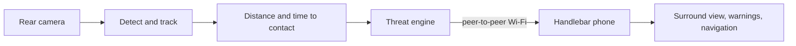

# 4sight 

> **See what's behind you.**

[](https://youtu.be/WKfXj8Th4Fk)

Tesla vision and navigation for bikes.

**[▶ Watch the demo](https://youtu.be/WKfXj8Th4Fk)** · Built at Hack the Valley 2026 
---

## Features

| Feature | Description |
|---------|-------------|
| 👀 **Vision** | YOLO11n on Core ML spots cars, trucks, buses, bikes and people behind you, 15 times a second |
| 🧠 **Prediction** | Tracks each vehicle, measures its distance and time to contact, predicts how close it will pass |
| 🗺️ **Surround view** | 3D street view with the cars behind you in their lanes |
| ⚠️ **Warning** | Flashing screen on the side of overtaking vehicles |
| 🎚️ **Calibration** | Adaptively ignores the bike's rear wheel |
| 🔒 **Privacy** | No data ever leaves the two phones |

---

## ⚙️ How it works



| Step | What happens | Built on |
|------|--------------|----------|
| **See** | Detect vehicles and people behind the bike, on the phone | [YOLO11n](https://docs.ultralytics.com/models/yolo11/), Core ML |
| **Track** | Keep each vehicle's identity frame to frame; mask the bike's own wheel | Our own tracker (Kalman + IoU) |
| **Measure** | Distance from each class's real size; seconds to contact from how fast its box grows | Swift, `FourSightKit/Perception` |
| **Decide** | Predict the passing gap; inside about a metre is a threat. A looming engine confirms faster | Swift, `FourSightKit/ThreatEngine` |
| **Guide** | Stream tracks to the handlebar phone; draw the street, the route and the cars | Apple peer-to-peer Wi-Fi, [OpenStreetMap](https://www.openstreetmap.org), MapKit |

---

## Run it yourself

### Prerequisites
- A Mac with Xcode 27
- Two iPhones on iOS 17 or later (iPhone XS or newer): one for the rear rack, one for the handlebars

### Build

```bash
git clone https://github.com/mdadfarr/4sight.git
cd 4sight
open 4sight/4sight.xcodeproj
```

Set your team under **Signing & Capabilities**, then run on both phones.

### Settings

The rear screen is just the camera's view, so its few switches live in the **Settings app → 4sight**
(read when the rear camera starts):

| Setting | Does |
|---------|------|
| Record video | Saves the rear camera's footage to the app's Documents, for replay and tuning |
| Demo: people and bikes alert | Lets someone walking at the camera trigger warnings, for indoor demos |
| Pair only with | Joins only the handlebar phone with that name ("This phone" on its home screen) |

---

## Usage

1. **Mount** → Rear phone on the rack, camera facing back; your phone on the handlebars
2. **Pick roles** → Open 4sight: **Rear rack** on one phone, **Handlebar** on the other. They connect on their own
3. **Search** → Pick a destination and a route on the handlebar phone
4. **Ride** → Follow the surround view; the screen edge flashes when a car is about to pass close
5. **Save battery** → Tap the moon on the rear phone to black out its screen; the camera keeps watching

---

## Map coverage

The surround view draws OpenStreetMap streets, sidewalks, crossings and buildings, bundled for
**central Toronto, UTSC, Waterloo, San Francisco, Manhattan and downtown Los Angeles**
(`4sight/Front/StreetRegions.json` has each box). Elsewhere, search and turn-by-turn still work and
the ride view draws the route alone. Add a city with:

```bash
uv run --project tools python tools/osm_streets.py --region <name> --bbox S,W,N,E --tile 0.03
```

---

## 🧪 What we tried first

| Idea | Tried | What happened |
|------|-------|---------------|
| Distance from one size for everything | Every detection treated as car-sized | A teammate 1 m away read as 4 m. Per-class sizes and smoothing fixed it |
| Warn from looming alone | Box growth only (how fast something gets bigger) | 198 seconds of false alarms on our ride footage. Now geometry decides and looming only confirms |
| More frames for better tracking | 10, 15, 20 and 30 fps on real footage | More frames made tracking worse. 15 fps won |
| Trust every detection | The model on the rear camera as-is | It saw the bike's own wheel as a person in half the frames. A learned mask cut 210 false boxes to 21 |
| Draw the street from the GPS trail, or use Apple Maps | Roads from GPS points; MapKit tiles | Glitched at every intersection; tiles were blank at cycling zoom. We bundle OpenStreetMap and draw it ourselves |

---

## 🛠️ Development

```bash
cd FourSightKit && swift test          # unit tests (needs Xcode)
swift run Checks                       # the same engines as plain asserts, plus fusion checks
swift run ReplayAlerts boxes.csv 15    # replay a recorded clip's detections through the alert chain
scripts/front-preview.sh               # the handlebar view on a scripted ride in the iOS Simulator
```

| Folder | What's in it |
|--------|--------------|
| `4sight/` | The iOS app: `App/` is the rear camera role, `Front/` the handlebar role |
| `FourSightKit/` | Swift package: protocol, perception (tracking, range, time to contact), threat engine, links |
| `ml/` | Python reference for detection, tracking and the danger logic ([ML notes](ml/README.md)) |
| `tools/` | OpenStreetMap street extraction; ride bag to footage conversion |
| `scripts/` | Run the app in the iOS Simulator on a scripted ride or a recorded rear clip |
| `docs/` | The rear → front message format ([contracts](docs/CONTRACTS.md)) and the screen design mock |
| `firmware/`, `cad/` | The hackathon prototype's handlebar grips (ESP32, 3D-printed housing); no longer used by the app |

The hackathon build also uploaded near misses to a public close-pass map of Toronto (Vercel, Tiger
Cloud, Leaflet). That is paused and out of the app; its code is at the
[`close-pass-map`](https://github.com/mdadfarr/4sight/tree/close-pass-map) tag.

---

## 👥 Credits

Jasper Sun, Arshiya Khayatzadeh, Shayan Dorouediani and Mohammed Dadfar.

Map data © OpenStreetMap contributors (ODbL).
