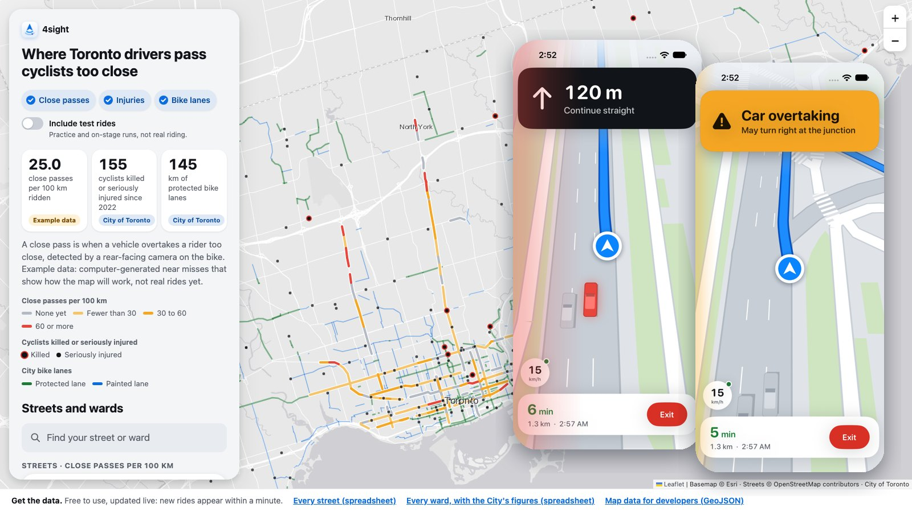
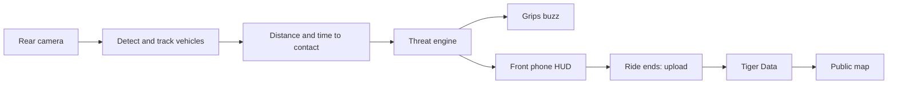

# 4sight

See what's behind you.

[](https://youtu.be/WKfXj8Th4Fk)

**[▶ Watch the demo](https://youtu.be/WKfXj8Th4Fk)** · **[Live map](https://4sight-map.vercel.app)**

**Built at Hack the Valley 2026 for the School of Cities track, MLH Best Use of Tiger Data and Best AI for Social Impact.**

Most close passes come from behind, where a cyclist can't see them, and none of them get
counted. Toronto records where cyclists get hurt and where the bike lanes are, but not how many
people ride each street or how often they are nearly hit.

4sight turns a spare iPhone into a rear-view camera for your bike. It watches the road behind
you with AI that runs entirely on the phone, and when a vehicle is about to pass too close, the
left handlebar grip buzzes. Press the button on either grip and it tells you whether that lane
is clear to move into. Your own phone on the handlebars does the navigation and shows the cars
behind you in their lanes.

When the ride ends, every near miss uploads by itself, anonymously, to a public map of where
Toronto's cyclists get close-passed: close passes per 100 km actually ridden, by street, ward and
type of bike lane, next to the City's own record of cyclists killed or seriously injured.

## How it works



| Step       | What happens                                                                                       | Built on                                                         |
| ---------- | -------------------------------------------------------------------------------------------------- | ---------------------------------------------------------------- |
| See        | Detect cars, trucks, buses, bikes and people behind the bike, 15 times a second, on the phone      | [YOLO11n](https://docs.ultralytics.com/models/yolo11/), Core ML  |
| Track      | Keep each vehicle's identity frame to frame; learn and ignore the bike's own wheel                 | Our own tracker (Kalman + IoU)                                   |
| Measure    | Distance from each class's real size; seconds to contact from how fast its box grows               | Swift, `FourSightKit/Perception`                                 |
| Decide     | Predict how close it will pass; inside about a metre is a threat. A looming engine confirms faster | Swift, `FourSightKit/ThreatEngine`                               |
| Warn       | Buzz and light the grip on that side; answer the merge buttons red or green                        | ESP32, Bluetooth LE, [NimBLE](https://github.com/h2zero/NimBLE-Arduino) |
| Guide      | Rear phone streams to the front phone; 3D street view, turn-by-turn, warnings before turns         | Apple peer-to-peer Wi-Fi, [OpenStreetMap](https://www.openstreetmap.org), MapKit directions |
| Upload     | Ride ends, ends of the route trimmed on the phone, sent anonymously                                | Vercel functions (Montreal)                                      |
| Count      | Match every point to a street, keep live totals per street and hour                                | [Tiger Cloud](https://www.tigerdata.com): TimescaleDB hypertables, PostGIS, real-time continuous aggregates |
| Show       | Close passes per 100 km by street, ward and lane type, beside the City's layers                    | Leaflet, City of Toronto Open Data                               |

No video ever leaves the bike. The database and the server are in Canada (AWS Canada Central,
Vercel Montreal). There are no accounts; the app sends a random per-install id and the database
keeps only its hash.

## What we tried first

| Idea                                     | Tried                                            | What happened                                                                 |
| ---------------------------------------- | ------------------------------------------------ | ----------------------------------------------------------------------------- |
| Distance from one size for everything    | Every detection treated as car-sized             | A teammate 1 m away read as 4 m. Per-class sizes and smoothing fixed it       |
| Warn from looming alone                  | Box growth only (how fast something gets bigger) | 198 seconds of false alarms on our ride footage. Now geometry decides and looming only confirms |
| More frames for better tracking          | 10, 15, 20 and 30 fps on real footage            | More frames made tracking worse. 15 fps won                                   |
| Trust every detection                    | The model on the rear camera as-is               | It saw the bike's own wheel as a person in half the frames. A learned mask cut 210 false boxes to 21 |
| Wi-Fi to the grips                       | ESP32 joining the phone's hotspot                | Needed an API a free developer account can't use. Moved to Bluetooth LE       |
| Draw the street from the GPS trail, or use Apple Maps | Roads from GPS points; MapKit tiles     | Glitched at every intersection; tiles were blank at cycling zoom. We bundle OpenStreetMap and draw it ourselves |

## Run it

You need a Mac with Xcode 27, two iPhones on iOS 26 (one rear, one on the handlebars), and the
grips: an ESP32 dev board, two coin vibration motors, a green and a red LED and a button per
grip. Wiring is in [firmware/README.md](firmware/README.md).

```sh
git clone https://github.com/mdadfarr/4sight.git
cd 4sight
open 4sight/4sight.xcodeproj        # set your team under Signing, run on both phones
cd firmware && pio run -t upload    # flash the grips (PlatformIO); Arduino IDE 2 also works
```

On the bike phone, open 4sight and pick **Rear**; on the handlebar phone, pick **Front**. The
two phones talk directly over Apple's peer-to-peer Wi-Fi, no router needed. The rear connects to
the grips by itself; don't pair it in iOS Settings.

| Setting (rear phone, Diagnostics)             | Does                                                              |
| --------------------------------------------- | ----------------------------------------------------------------- |
| Demo: people and bikes trigger alerts         | Lets a person walking or jogging at the camera trigger warnings, for indoor demos. Rides recorded with it on are labelled test rides |
| Pair only with front named                    | Joins only the front phone with that name ("This phone" on its home screen) |
| Forget wheel position                         | Relearn the bike's wheel after moving the mount                   |
| Record video to Documents                     | Saves the rear camera's footage, for replay and tuning            |

### Checks and tools

```sh
cd FourSightKit && swift run Checks                     # threat engine, tracker, protocol, upload checks
swift run ReplayAlerts boxes.csv 15                     # replay a recorded clip's detections through the full alert chain
scripts/front-preview.sh                                # the front phone on a scripted ride in the iOS Simulator
```

### Server and map

The server and database setup, the live demo queries for Tiger Cloud's SQL editor and the
upload contract are in [server/README.md](server/README.md), [server/demo.sql](server/demo.sql)
and [docs/DATA_PIPELINE.md](docs/DATA_PIPELINE.md). The website is in [web/](web/); the live map
is at [4sight-map.vercel.app](https://4sight-map.vercel.app), with open data downloads:
[every street](https://4sight-server.vercel.app/v1/streets.csv),
[every ward](https://4sight-server.vercel.app/v1/wards.csv),
[GeoJSON](https://4sight-server.vercel.app/v1/city-risk.geojson).

## Data

| Source                                                                                     | Used for                                         |
| ------------------------------------------------------------------------------------------ | ------------------------------------------------ |
| [City of Toronto Cycling Network](https://open.toronto.ca/dataset/cycling-network/)        | Street segments and lane type (protected, painted, shared) |
| [City of Toronto City Wards](https://open.toronto.ca/dataset/city-wards/)                  | Ward of every segment                            |
| City of Toronto Vision Zero, cyclists killed or seriously injured, 2022 to October 2026    | Injury layer and ward figures                    |
| [OpenStreetMap](https://www.openstreetmap.org/copyright) contributors                      | Streets without cycling infrastructure; the app's street drawing |
| 4sight rides                                                                               | Kilometres ridden and close passes               |

Until real rides add up, most close-pass numbers on the map are modelled and labelled
**example data**, and stage rides are labelled **test rides**. Neither is presented as a finding.

## More

- [Data pipeline contract](docs/DATA_PIPELINE.md): what the app sends, the database, the public GeoJSON.
- [Pitch notes](docs/PITCH_NOTES.md): data residency, privacy, verified City numbers.
- [Firmware](firmware/README.md): wiring, pins, flashing, serial test commands.
- [ML](ml/README.md): the Python detection, tracking and danger logic the Swift port started from.

## Credits

Jasper Sun, Arshiya Khayatzadeh, [teammate], [teammate].

Map data © OpenStreetMap contributors. City data from the City of Toronto Open Data portal.
