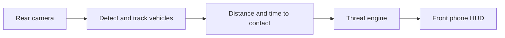

# 4sight

See what's behind you.

[](https://youtu.be/WKfXj8Th4Fk)

**[▶ Watch the demo](https://youtu.be/WKfXj8Th4Fk)**

**Built at Hack the Valley 2026 for the School of Cities track, MLH Best Use of Tiger Data and Best AI for Social Impact.**

Most close passes come from behind, where a cyclist can't see them.

4sight turns a spare iPhone into a rear-view camera for your bike. It watches the road behind
you with AI that runs entirely on the phone. Your own phone on the handlebars does the
navigation, shows the cars behind you in their lanes, and flashes a warning on the side a
vehicle is about to pass too close.

Everything runs on the two phones. No video, location or ride data leaves them, and there are
no accounts.

## How it works



| Step       | What happens                                                                                       | Built on                                                         |
| ---------- | -------------------------------------------------------------------------------------------------- | ---------------------------------------------------------------- |
| See        | Detect cars, trucks, buses, bikes and people behind the bike, on the phone: 15 times a second, 10 once the phone is warm, 5 near overheating | [YOLO11n](https://docs.ultralytics.com/models/yolo11/), Core ML  |
| Track      | Keep each vehicle's identity frame to frame; learn and ignore the bike's own wheel, and ask for a higher mount if it hides too much | Our own tracker (Kalman + IoU)                                   |
| Measure    | Distance from each class's real size; seconds to contact from how fast its box grows               | Swift, `FourSightKit/Perception`                                 |
| Decide     | Predict how close it will pass; inside about a metre is a threat. A looming engine confirms faster | Swift, `FourSightKit/ThreatEngine`                               |
| Warn       | Flash the edge of the handlebar screen on the side the vehicle is coming                            | SwiftUI                                                          |
| Guide      | Rear phone streams to the front phone; 3D street view, turn-by-turn, warnings before turns         | Apple peer-to-peer Wi-Fi, [OpenStreetMap](https://www.openstreetmap.org), MapKit directions |

## What we tried first

| Idea                                     | Tried                                            | What happened                                                                 |
| ---------------------------------------- | ------------------------------------------------ | ----------------------------------------------------------------------------- |
| Distance from one size for everything    | Every detection treated as car-sized             | A teammate 1 m away read as 4 m. Per-class sizes and smoothing fixed it       |
| Warn from looming alone                  | Box growth only (how fast something gets bigger) | 198 seconds of false alarms on our ride footage. Now geometry decides and looming only confirms |
| More frames for better tracking          | 10, 15, 20 and 30 fps on real footage            | More frames made tracking worse. 15 fps won                                   |
| Trust every detection                    | The model on the rear camera as-is               | It saw the bike's own wheel as a person in half the frames. A learned mask cut 210 false boxes to 21 |
| Wi-Fi to the grips                       | ESP32 joining the phone's hotspot                | Needed an API a free developer account can't use. Moved to Bluetooth LE       |
| Draw the street from the GPS trail, or use Apple Maps | Roads from GPS points; MapKit tiles     | Glitched at every intersection; tiles were blank at cycling zoom. We bundle OpenStreetMap and draw it ourselves |

## Repository

| Folder           | What's in it                                                                          |
| ---------------- | ------------------------------------------------------------------------------------- |
| `4sight/`        | The iOS app: `App/` is the rear camera role, `Front/` the handlebar role              |
| `FourSightKit/`  | Swift package: protocol, perception (tracking, range, time to contact), threat engine, links |
| `firmware/`      | ESP32 grip firmware from the hackathon prototype; the app no longer uses the grips    |
| `cad/`           | The prototype's 3D-printed grip housing: STEP and STL per part, a print plate         |
| `tools/`         | OpenStreetMap street extraction for the app's map; ride bag to footage conversion     |
| `ml/`            | Python reference for detection, tracking and the danger logic                         |
| `scripts/`       | Run the app in the iOS Simulator on a scripted ride or a recorded rear clip           |
| `docs/`          | Protocol contracts and the front screen design mock                                   |

## Run it

You need a Mac with Xcode 27 and two iPhones on iOS 17 or later (iPhone XS or newer): one on a
rear rack, one on the handlebars.

```sh
git clone https://github.com/mdadfarr/4sight.git
cd 4sight
open 4sight/4sight.xcodeproj        # set your team under Signing, run on both phones
```

On the rear phone, open 4sight and pick **Rear rack**; on the handlebar phone, pick
**Handlebar**. The two phones talk directly over Apple's peer-to-peer Wi-Fi, no router needed.
The rear screen is just the camera's view, with whether the handlebar phone is connected and a
**Screen off** button that keeps the camera running. The rear learns the bike's own wheel by
itself, relearns it when the mount moves, and asks for a higher mount if the wheel hides too
much of the road.

| Setting (Settings app → 4sight, read when the rear camera starts) | Does                                    |
| ----------------------------------------------------------------- | --------------------------------------- |
| Record video                                                      | Saves the rear camera's footage to the app's Documents, for replay and tuning |
| Demo: people and bikes alert                                      | Lets a person walking or jogging at the camera trigger warnings, for indoor demos |
| Pair only with                                                    | Joins only the handlebar phone with that name ("This phone" on its home screen) |

### Checks and tools

```sh
cd FourSightKit && swift test                           # unit tests (needs Xcode)
swift run Checks                                        # the same engines as plain asserts, plus fusion and merge checks
swift run ReplayAlerts boxes.csv 15                     # replay a recorded clip's detections through the full alert chain
scripts/front-preview.sh                                # the front phone on a scripted ride in the iOS Simulator
```

## Data

The handlebar map draws OpenStreetMap streets, sidewalks, crossings and buildings
(© OpenStreetMap contributors, ODbL), bundled for central Toronto, UTSC, Waterloo, San Francisco,
Manhattan and downtown Los Angeles (`4sight/Front/StreetRegions.json` has each box). Elsewhere,
search and turn-by-turn still work and the ride view draws the route alone. Add a city with
`tools/osm_streets.py --region <name> --bbox S,W,N,E --tile 0.03`.

The hackathon build also uploaded near misses to a public close-pass map of Toronto (Vercel,
Tiger Cloud, Leaflet). That is paused and out of the app; its code is at the
[`close-pass-map`](https://github.com/mdadfarr/4sight/tree/close-pass-map) tag.

## More

- [Contracts](docs/CONTRACTS.md): the rear → front message, and the prototype's grip Bluetooth protocol.
- [Firmware](firmware/README.md): the prototype grips' wiring, pins and flashing.
- [ML](ml/README.md): the Python detection, tracking and danger logic the Swift port started from.

## Credits

Jasper Sun, Arshiya Khayatzadeh, Shayan Dorouediani and Mohammed Dadfar.

Map data © OpenStreetMap contributors.
